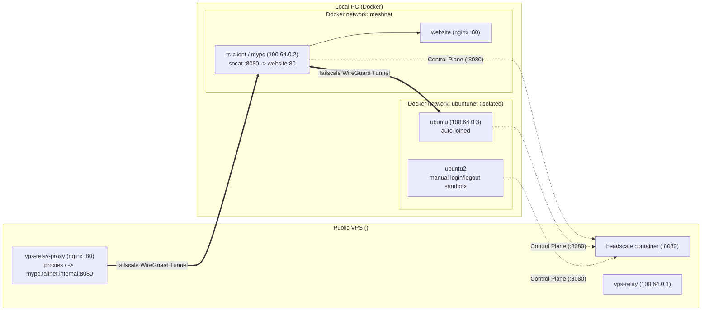

# try-headscale

Hands-on sandbox for running a self-hosted [Headscale](https://github.com/juanfont/headscale) control server on a VPS (using only an IPv4 address, no domain required) and connecting isolated Docker containers on your PC over a Tailscale mesh network (tailnet).

---

## Architecture



- `website` (`nginx:alpine`) has **no published host ports** and lives on the `meshnet` Docker bridge.
- `ubuntu` and `ubuntu2` live on a completely separate `ubuntunet` Docker bridge — they **cannot** reach `website` via Docker networking and can **only** reach it over the Headscale/Tailscale tailnet (`http://mypc:8080` or `http://100.64.0.2:8080`).

---

## Prerequisites

- **VPS**: Ubuntu 24.04 droplet/VM with a public IPv4 address and root SSH key access (defaults to `~/.ssh/id_ed25519`).
- **Local PC**: Docker & Docker Compose, `rsync`, and `ssh`.

---

## Quick Start: How to Play With This Project

### 1. Deploy Headscale on the VPS

From the repository root on your PC, run [server-setup.sh](server-setup.sh) with your VPS IP:

```bash
export VPS_IP="104.248.156.42"
./server-setup.sh
```

What this does:
1. Installs Docker on the VPS if not already installed.
2. Syncs [headscale-server/](headscale-server/) to `~/headscale-server` on the VPS.
3. Starts Headscale on `http://${VPS_IP}:8080`, creates default user `myuser`, joins the VPS itself as `vps-relay` (`100.64.0.1`), and prints a reusable `TS_AUTHKEY` for your PC.

Custom SSH key or user (optional):
```bash
VPS_IP="104.248.156.42" \
SSH_PRIV_KEY=~/.ssh/id_ed25519 \
SSH_PUB_KEY=~/.ssh/id_ed25519.pub \
SSH_USER=root \
./server-setup.sh
```

---

### 2. Connect Your PC Containers to the Tailnet

Copy the `VPS_IP=... TS_AUTHKEY=...` command printed at the end of step 1 and run it inside [headscale-client/](headscale-client/):

```bash
cd headscale-client
VPS_IP="104.248.156.42" TS_AUTHKEY="hskey-auth-..." ./headscale-client-connect.sh
```

This starts 4 containers:
- `website`: Nginx serving `<h1>hello from my PC!</h1>`
- `ts-client` (`mypc`): Joins the tailnet and forwards tailnet port `:8080` to `website:80`
- `ubuntu`: Joins the tailnet automatically so you can test `curl` right away
- `ubuntu2`: Has `tailscale` and `curl` installed, left disconnected so you can practice manual login/logout

---

### 3. Access the Website (Publicly via VPS IP or Over the Tailnet)

**Option A: From the public internet (any browser or device, without Tailscale):**
Open `http://<VPS_IP>/` (port `80`):
```bash
curl http://104.248.156.42/
```
The `vps-relay-proxy` nginx container on the VPS resolves `mypc.tailnet.internal` via Tailscale MagicDNS (`100.100.100.100`) and proxies port `:80` over the tailnet to `mypc:8080` -> `website:80`.

**Option B: From inside the `ubuntu` tailnet container:**
Open a shell inside the `ubuntu` container using [ubuntu-tailnet.sh](ubuntu-tailnet.sh):

```bash
./ubuntu-tailnet.sh
```

Inside `ubuntu`, test reaching `website` over the tailnet by Tailscale IP or MagicDNS name:

```bash
# Check tailnet peers
tailscale status

# Curl via Tailscale IPv4
curl http://100.64.0.2:8080

# Curl via MagicDNS hostname
curl http://mypc:8080
```

Both return:
```html
<h1>hello from my PC!</h1>
```

---

### 4. Playground Scenarios to Try

#### Scenario A: Create a New User & Token, Then Manually Connect `ubuntu2`

1. On your PC, create a user and generate a login token:
   ```bash
   VPS_IP="104.248.156.42" ./headscale-server/scripts/create-user.sh alice
   VPS_IP="104.248.156.42" ./headscale-server/scripts/create-token.sh alice 1h
   ```
2. Open a shell in `ubuntu2`:
   ```bash
   docker exec -it ubuntu2 bash
   ```
3. Inside `ubuntu2`, log into the tailnet interactively (or with env vars):
   ```bash
   # Interactive prompt (asks for VPS_IP, TS_AUTHKEY, TS_HOSTNAME):
   /scripts/tailnet-login-prompt.sh

   # Or one-liner:
   VPS_IP="104.248.156.42" TS_AUTHKEY="hskey-auth-..." /scripts/tailnet-login.sh
   ```
4. Test curling `mypc` from `ubuntu2`:
   ```bash
   curl http://mypc:8080
   ```
5. Log `ubuntu2` out from inside the container:
   ```bash
   /scripts/tailnet-logout.sh
   ```

#### Scenario B: Inspect Users, Machines, and Tokens from Your PC

```bash
# List all users in Headscale
VPS_IP="104.248.156.42" ./headscale-server/scripts/list-users.sh

# List all connected/registered machines
VPS_IP="104.248.156.42" ./headscale-server/scripts/list-machines.sh

# List all preauth tokens
VPS_IP="104.248.156.42" ./headscale-server/scripts/list-tokens.sh
```

#### Scenario C: Kick a Machine or Revoke a Compromised Token

```bash
# Kick a machine by hostname, tailnet IP, or numeric Node ID
VPS_IP="104.248.156.42" ./headscale-server/scripts/kick-machine.sh ubuntu2

# Revoke a specific token (by full token, prefix, or ID)
VPS_IP="104.248.156.42" ./headscale-server/scripts/revoke-token.sh hskey-auth-...

# Revoke ALL preauth tokens
VPS_IP="104.248.156.42" ./headscale-server/scripts/revoke-token.sh --all
```

---

## Reference Docs

- [TAILSCALE-CHEATSHEET.md](TAILSCALE-CHEATSHEET.md) — Headscale server & Tailscale client CLI reference.
- [TOKEN-COMPROMISE-PLAYBOOK.md](TOKEN-COMPROMISE-PLAYBOOK.md) — What happens when a preauth token or node is compromised and how to respond.
